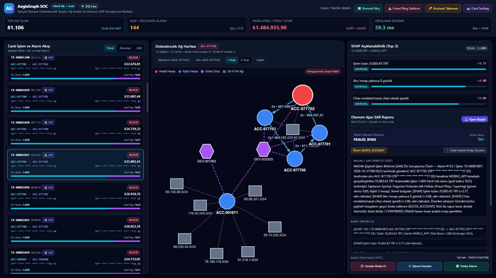
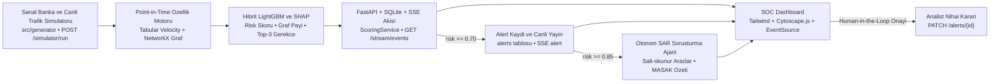

# 🛡️ AegisGraph

Hibrit (ML + Graf Analizi) ve otonom gerçek zamanlı dolandırıcılık tespit sistemi.

[](https://huggingface.co/spaces/kdemirwarehouse/aegisgraph)


[](https://github.com/kdemirwarehouse/aegisgraph/actions/workflows/ci.yml)


> 🚀 **Canlı demo:** [huggingface.co/spaces/kdemirwarehouse/aegisgraph](https://huggingface.co/spaces/kdemirwarehouse/aegisgraph) — kurulum gerektirmeden SOC Dashboard'u açıp simülatör butonlarıyla canlı fraud trafiği başlatabilirsiniz.


*Canlı SOC Dashboard: Gerçek zamanlı SSE işlem/alarm akışı (sol), Cytoscape.js dolandırıcılık halkası ağ haritası (orta), Türkçe SHAP top-3 risk faktörleri ve Otonom Ajan MASAK/SAR soruşturma raporu (sağ).*

Klasik kural motorları ve tekil işlem modelleri, koordineli dolandırıcılığı (fraud halkaları, mule ağları, paylaşılan cihazlar) göremez. AegisGraph her işlemi iki açıdan değerlendirir:

1. **ML skoru:** İşlem ve hesap davranışı özellikleri üzerinde LightGBM
2. **Graf skoru:** Hesap–cihaz–işlem ağında döngüler, ortak cihazlar, fan-in/fan-out ve bileşen yapısı

Yüksek riskli işlemler **Alert** üretir. Otonom bir soruşturma ajanı kanıt toplayıp analiste açıklanabilir bir rapor sunar.



## Kurulum

Gereksinim: **Python ≥ 3.10** (geliştirme 3.11+, Hugging Face Spaces 3.10)

```bash
cd aegisgraph
python -m venv .venv
.\.venv\Scripts\Activate.ps1          # Linux/macOS: source .venv/bin/activate
pip install -r requirements-dev.txt     # çalışma zamanı + pytest/ruff (sadece çalıştırmak için: requirements.txt)
copy .env.example .env                 # isteğe bağlı
```

## Sentetik veri üretimi

```bash
python -m src.generator.synthetic_data                          # varsayılan: 2.000 müşteri, 30 gün
python -m src.generator.synthetic_data --customers 5000 --days 60 --seed 7
python -m src.generator.synthetic_data --no-db                   # sadece CSV
```

**Çıktılar:**
- `data/raw/{accounts,devices,account_devices,transactions}.csv`
- `data/aegisgraph.db` (SQLite: `accounts`, `devices`, `account_devices`, `transactions`, `alerts`)

## Model eğitimi

```bash
python -m src.models.train            # özellik çıkarımı → eğitim → artifacts/ → alerts tablosu
```

Sonuçlar `artifacts/report.md` dosyasında. Test seti = son 5 gün (temporal hold-out):

| Metrik | LightGBM (hibrit) | LightGBM (graf yok) | LogReg baseline |
| :--- | :---: | :---: | :---: |
| **PR-AUC** | **0.9992** | 0.7112 | 0.9089 |
| **ROC-AUC** | **1.0000** | 0.9482 | 0.9984 |
| **Recall @ %1 FPR** | **1.000** | 0.693 | 0.986 |

Graf özellikleri çıkarıldığında Money Mule recall'u `1.00 → 0.25`'e düşüyor: hibrit mimarinin katkısı en net bu senaryoda görülür. *Not: Veri sentetik olduğundan metrikler gerçek bankacılık verisine göre iyimser bir üst sınırdır.*

Her alert için SHAP ile en çok riski artıran 3 faktör Türkçe olarak saklanır:

```text
TX-00067511  MONEY_MULE  risk=0.962  graf payı=%43
  +3.63  Alıcı bir üye işyeri değil (kişi/kurum hesabına transfer)
  +2.60  İşlem tutarı 7,964.76 TRY
  +2.55  Alıcı şimdiye kadar 0 farklı hesaba para gönderdi
```

## Testler

```bash
pytest          # 87 test: generator, özellik/model, API, ajan, dashboard
ruff check .
```

GitHub Actions (`.github/workflows/ci.yml`) her push ve PR'da `ruff` ve testleri Python 3.10 ve 3.11'de çalıştırır.

## SOC Dashboard ve gerçek zamanlı API

Sıfır Node.js kurulumu gerektirmeyen etkileşimli SOC Dashboard doğrudan FastAPI tarafından servis edilir:

```bash
python -m src.api.main                          # FastAPI + SSE + Dashboard (http://127.0.0.1:8000)
python -m src.api.simulator --count 30 --tps 5  # CLI üzerinden canlı trafik basar
```

Tarayıcıda `http://127.0.0.1:8000/` (veya `/dashboard`) adresini açtığınızda:
- **Üst Bar (KPI & Demo Kontrolü):** `● SSE Live` bağlantı göstergesi, toplam işlem, açık alarm, riskli tutar (`₺`), ortalama gecikme kartları ve `POST /simulator/run` ucunu çağıran tek tık demo butonları (`Normal Akış`, `Fraud Ring`, `Account Takeover`, `Card Testing`).
- **Sol Sütun (%30):** SSE (`GET /stream/events`) üzerinden akan maskeli IBAN'lı işlemler, karar rozetleri (`ALLOW` / `REVIEW` / `ALERT` / `BLOCK`) ve `ml_score` vs `graph_score` katkı çubuğu.
- **Orta Sütun (%40):** Cytoscape.js ile `GET /graph/{account_id}` komşuluk haritası (hedef hesap, ilişkili hesaplar, ortak cihazlar, `/24` IP alt ağları) ve `1-Hop / 2-Hop` geçiş kontrolü.
- **Sağ Sütun (%30):** Türkçe SHAP top-3 etki çubukları, otonom ajan SAR raporu (`POST /alerts/{alert_id}/investigate`) ve Human-in-the-Loop analist karar butonları (`PATCH /alerts/{alert_id}`).

API uçları:
- `GET /`, `GET /dashboard` — Etkileşimli SOC Dashboard arayüzünü servis eder (`/static/*` statik dosyalarıyla)
- `POST /transactions/score` — Tekil işlemi milisaniyeler içinde skorlar, graf payı ve SHAP top-3 gerekçeleri döner
- `POST /simulator/run` — Seçilen senaryo (`ALL`, `NORMAL`, `FRAUD_RING`, `ACCOUNT_TAKEOVER`, `CARD_TESTING`) için arka planda canlı trafik başlatır
- `GET /stream/events` — Yeni işlemleri (`transaction`), alarmları (`alert`) ve otonom soruşturmaları (`investigation`, `investigation_failed`) Server-Sent Events (SSE) ile canlı yayınlar
- `GET /alerts`, `GET/PATCH /alerts/{alert_id}` — Alarmları filtreler, görüntüler ve durum günceller
- `POST /alerts/{alert_id}/investigate` — İlgili alarm için otonom soruşturmayı başlatır ve SAR raporunu kaydeder
- `GET /alerts/{alert_id}/investigation` — Kayıtlı otonom soruşturma (SAR) raporunu döndürür
- `GET /graph/{account_id}` — Şüpheli hesabın para akışı ve cihaz/IP komşuluk alt grafını JSON olarak döner

## Docker ve Hugging Face Spaces

```bash
docker build -t aegisgraph .            # build sırasında sentetik veri üretilir ve model eğitilir
docker run -p 7860:7860 aegisgraph      # http://localhost:7860
```

Docker imajı ve Hugging Face Spaces aynı giriş noktasını (`app.py`) kullanır: eksikse veri ve modeli ilk açılışta üretir, FastAPI uygulamasını (API + SSE + Dashboard) Gradio ile aynı sunucuya bağlar ve `7860` portundan yayınlar.

### Yazma uçları için API anahtarı (opsiyonel)

Varsayılan demo modunda uçlar açıktır. `AEGIS_API__WRITE_API_KEY` tanımlanırsa yazma uçları (`POST /transactions/score`, `PATCH /alerts/{id}`, `POST /alerts/{id}/investigate`, `POST /simulator/run`) `X-API-Key` başlığı ister, yoksa `401` döner. Okuma uçları ve SSE akışı açık kalır. Dashboard `401` aldığında anahtarı bir kez sorar ve oturum boyunca (`sessionStorage`) hatırlar. `GET /health` yanıtındaki `write_auth_required` alanı anahtarın aktif olup olmadığını gösterir.

```bash
curl -X PATCH http://127.0.0.1:8000/alerts/12 -H "X-API-Key: $AEGIS_API__WRITE_API_KEY"      -H "Content-Type: application/json" -d '{"status": "INVESTIGATING"}'
```

## Otonom soruşturma ajanı

Kritik alarmlarda (`AEGIS_AGENT__AUTO_INVESTIGATE_MIN_SCORE`, varsayılan `0.85`) otomatik tetiklenen veya `POST /alerts/{alert_id}/investigate` ile çağrılan `FraudInvestigatorAgent` (`src/agent/`), salt-okunur kanıt araçlarıyla (`get_alert_evidence`, `get_account_profile`, `get_recent_transactions`, `get_network_connections`) delil zinciri toplar, tüm IBAN'ları maskeler ve Türkçe MASAK/SAR formatında rapor üretir:

- **Tipolojiler:** `FRAUD_RING`, `ACCOUNT_TAKEOVER`, `MONEY_MULE`, `CARD_TESTING`, `ANOMALOUS_ACTIVITY`
- **Human-in-the-Loop:** Önerilen aksiyonlar (`BLOCK_ACCOUNT`, `FREEZE_TX`, `ENHANCED_DUE_DILIGENCE`, `FALSE_POSITIVE_DISMISS`) daima `requires_human_approval=true` ile insan analist onayına sunulur; alarm en fazla `INVESTIGATING` durumuna alınır, asla otomatik `CONFIRMED_FRAUD` olmaz.
- **Rapor alanları (`InvestigationReport`):** `alert_id`, `tx_id`, `suspected_typology`, `confidence_score`, `executive_summary_tr`, `evidence_chain` (kaynak işlem/cihaz/IP kimlikli), `related_accounts`, `recommended_action`, `tool_trace`. Raporlar `investigations` tablosunda saklanır.
- **KVKK / gizlilik:** IBAN'lar `mask_iban` ile (`TR** **** **** **** **** **12 34`), hesap sahibi adları `mask_holder_name` ile maskelenir; tüm araç, rapor ve LLM çıktıları ayrıca `redact_ibans` süzgecinden geçer.
- **Point-in-time:** Araçlar yalnızca alarm anına kadarki veriyi kullanır; ground-truth etiketlerine hiçbir koşulda erişmez.
- **Sağlayıcı:** Varsayılan `local` mod harici API anahtarı gerektirmeden deterministik kanıt sentezi yapar. Opsiyonel OpenAI uyumlu LLM modu (`AEGIS_AGENT__PROVIDER=openai`, `AEGIS_AGENT__API_KEY`, `AEGIS_AGENT__LLM_BASE_URL`) yalnızca yönetici özetini zenginleştirir; hata durumunda yerel özete dönülür.
- **Dayanıklılık:** Otomatik soruşturma başarısız olursa skorlama yanıtı etkilenmez; alarm `OPEN` kalır ve SSE akışına `investigation_failed` olayı düşer.
- **Ayarlar:** Tüm eşikler (`max_tool_steps`, `history_lookback_days`, `mule_min_fan_in`, `card_testing_min_burst`, `min_typology_signal`, `block_min_confidence` vb.) `config/settings.py` → `AgentSettings` (`settings.agent`) altındadır.

## Veri modeli

| Tablo | Açıklama |
| :--- | :--- |
| `accounts` | Bireysel / kurumsal / üye işyeri hesapları, geçerli TR IBAN, KYC seviyesi |
| `devices` | Cihaz parmak izi, tip, emülatör bayrağı |
| `account_devices` | Hesap ↔ cihaz kenarları (graf için bipartit ilişki) |
| `transactions` | Tutar (kuruş), kanal, IP, konum + ground-truth etiketleri |
| `alerts` | Risk skoru, graf katkı payı ve SHAP gerekçeleri |
| `investigations` | Otonom soruşturma ajanının ürettiği SAR raporu, kanıt zinciri ve öneri |

## Fraud senaryoları

| Senaryo | Nasıl modellendi |
| :--- | :--- |
| **Fraud Ring** | 4-8 yeni hesap, ortak cihaz ve IP alt ağı; kurbandan giren para dakikalar içinde A→B→…→A döngüsünde birkaç tur döner |
| **Account Takeover** | Kurbanın hesabına yeni cihaz + yabancı IP ile girilir, normal tutarın 8-30 katı transferler; saldırgan cihazı birden fazla kurbanda tekrar görülür |
| **Money Mule** | 15-40 kurbandan tek hub hesaba fan-in, saatler içinde 3-6 cash-out hesabına fan-out |
| **Card Testing** | Saniyeler arayla 1-20 TRY'lik denemeler, ardından büyük e-ticaret alışverişi |

Varsayılan ayarlarla ~81 bin işlemin yaklaşık %1.0'ı fraud (gerçekçi sınıf dengesizliği). Meşru trafikte de fraud'a benzeyen davranışlar (seyahat, VPN, telefon değişimi, aile cihazı, mikro-ödeme seansları) bulunur; model tek bir kısayol özelliğe yaslanamaz. Hesap ve cihaz ID'leri rastgele permüte edilir; fraud hesapları ID sırasından tanınamaz.

## Konfigürasyon

Tüm parametreler `config/settings.py` içinde (Pydantic `BaseSettings`), `AEGIS_` önekli ortam değişkenleriyle ezilebilir (iç içe alanlar için `__`):

```env
AEGIS_GENERATOR__N_CUSTOMERS=5000
AEGIS_RISK__ALERT_SCORE=0.65
```

## Proje yapısı

```text
aegisgraph/
├── .antigravity/rules.md      # Domain + kod kuralları (ajanlar için bağlayıcı)
├── CLAUDE.md                  # Mimari ve teknik kurallar
├── config/settings.py         # Merkezi konfigürasyon
├── .github/workflows/ci.yml   # GitHub Actions: ruff + pytest (3.10 / 3.11)
├── data/raw/                  # Üretilen veri (git'e girmez)
├── src/
│   ├── database/              # ORM + Pydantic şemalar, engine, toplu yükleme
│   ├── generator/             # Sentetik veri motoru
│   ├── features/              # Tabular + graf özellikleri, FeatureExtractor
│   ├── models/                # Train, explainer (SHAP), scorer (alert)
│   ├── api/                   # Gerçek zamanlı skorlama API, SSE akışı ve simülatör tetikleyicisi
│   ├── agent/                 # Otonom soruşturma ajanı ve SAR raporlayıcı
│   └── dashboard/             # Sıfır Node.js SOC Dashboard arayüzü (index.html, styles.css, app.js)
├── app.py                     # Hugging Face Spaces giriş noktası (Gradio + FastAPI)
├── Dockerfile                 # Konteyner imajı (build'de veri + eğitim)
├── artifacts/                 # report.md, metrics.json (model ikilileri git dışı)
└── tests/                     # test_generator.py, test_features_and_model.py, test_api.py, test_agent.py, test_dashboard.py
```

## Bilinen sınırlamalar ve yol haritası

- **Sentetik veri:** Metrikler (PR-AUC ≈ 0.999) sentetik senaryolar üzerindedir; gerçek veride performans daha düşük olacaktır. Sıradaki adım: IEEE-CIS / PaySim gibi açık veri setlerinde doğrulama.
- **Money Mule @ alert eşiği:** Operating point'te recall 1.00 iken `0.70` alert eşiğinde ~0.75; mule hub'ları için eşik kalibrasyonu veya ayrı bir hesap-seviyesi model planlanıyor.
- **Tek süreç / SQLite:** `ScoringService` durumu bellekte tutar; yatay ölçekleme için PostgreSQL + paylaşımlı özellik deposu (Redis) gerekir.
- **Kimlik doğrulama:** Yazma uçları için opsiyonel API anahtarı var; üretim için analist bazlı OAuth2/JWT ve rol bazlı yetki (RBAC) eklenmelidir.
- **Model sürümleme / drift izleme:** MLflow ile model kaydı ve özellik dağılımı drift alarmı henüz yok.

## Lisans ve uyarı

[MIT](LICENSE) lisansı ile dağıtılır. Tüm veriler sentetiktir; gerçek kişi veya hesap bilgisi içermez. Proje eğitim ve portföy amaçlıdır.
